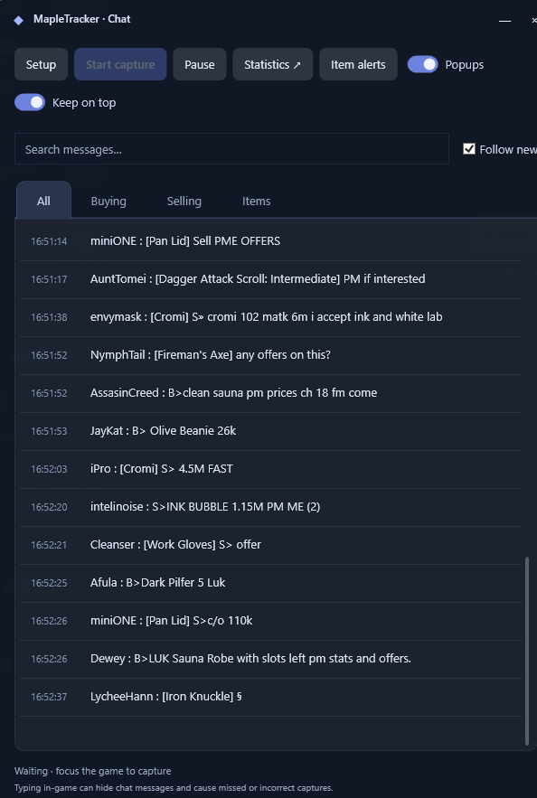
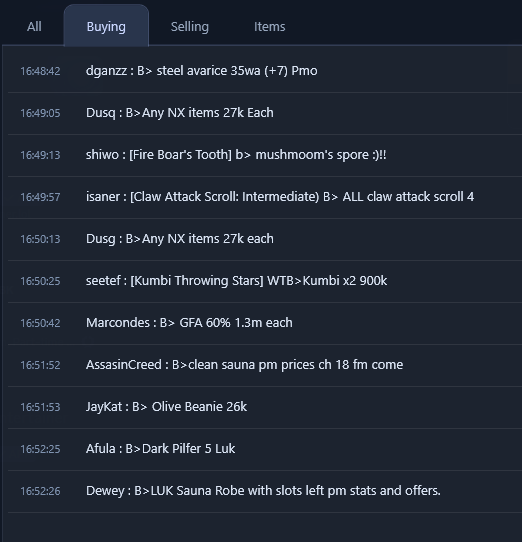
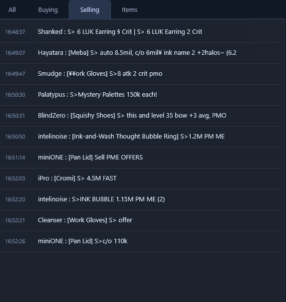
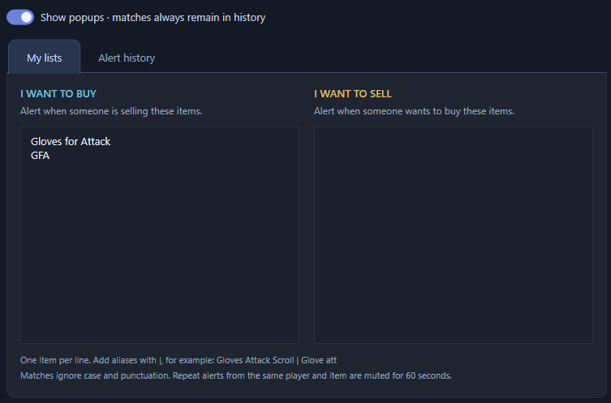
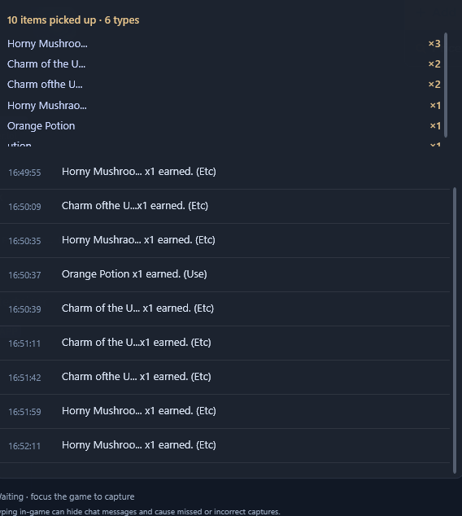
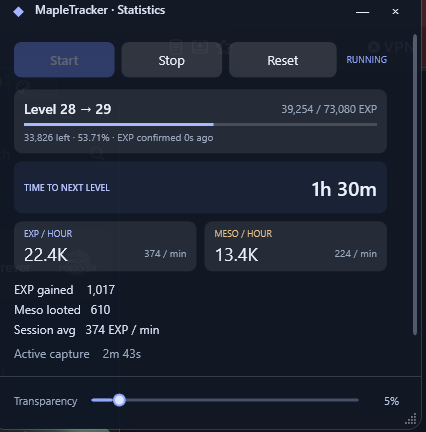

# MapleTracker 1.0

MapleTracker is a Windows companion for MapleStory. It reads visible game text and puts chat, market messages, picked-up items, and training statistics in movable windows beside the game. It does not send chat, control your character, or read game memory.

MapleTracker works best while farming in quieter maps. Crowded maps with lots of people and rapid chat spam can make recognition less reliable, causing missed or misread messages and alerts.

## Start here

1. Run MapleTracker.exe. The Windows x64 release includes its runtime, OCR engine, English recognition model, and EXP table. You do not need to install .NET or keep library/model files beside the EXE.
2. Run the game in windowed or borderless mode. Keep the text you want to capture visible.
3. Click Setup, choose MapleStory, and Take snapshot. Tracker windows briefly disappear from the snapshot without closing Setup.
4. Select each region and draw a box around its text: Chat messages, Loot notifications, Level number, and EXP number + percentage. Include every loot notification row you want to track. For EXP, include both the number and percentage, not just the yellow bar.
5. For the recommended compact layout, collapse in-game chat to one white/gray bar and click Use white chat bar. Leave Chat history only off. Adjust the default box if your layout differs.
6. Click Test recognition, review the text, then Save setup. Move tracker windows away from the selected game regions.
7. Click Start capture and focus the game.

Capture waits while the game is unfocused, minimized, or covered by another window over a selected text region. Exclusive fullscreen is not supported. The boxes follow window movement and scale with its size, but changing the game's UI layout may require new boxes.

Saving a different capture source or different regions begins a new displayed session, clearing chat, item totals, alerts, and statistics. Existing session journals stay on disk.

Typing in-game can replace the received message with your draft, causing missed or incorrect captures. MapleTracker shows this reminder in white-bar mode. It cannot recover messages hidden by the game while you type.

## Chat window

<!-- screenshots:start -->

<!-- screenshots:end -->

- All: recognized incoming chat messages. Pickup notifications have their own Items tab.
- Buying: messages recognized as someone wanting to buy something.
- Selling: messages recognized as someone selling something.
- Items: recognized item pickup notifications and totals by item name.
- Search messages: filter the tab you are viewing by a name, item, or phrase. It does not send anything to the game or change your watchlists.
- Follow new: automatically scroll to new entries. Turn it off to read older messages.
- Start capture / Pause: start or pause OCR for chat, loot, alerts, and statistics. Pause preserves the current session.
- Statistics: open or bring back the separate statistics window.
- Item alerts: edit your buying/selling watchlists and see match history. The number in parentheses is the number of retained matches.
- Popups: enable or disable visible matching-item notifications. Match history continues while popups are off.
- Keep on top: keep chat and statistics above other windows.
- Help: open this guide or the bundled third-party notices.

Drag a window by its title bar and resize it using its bottom-right corner. Chat and statistics each have their own Transparency slider; changing one does not change the other. Text stays opaque for readability. Positions, sizes, transparency, and preferences are saved.

## Set your own buying and selling tags

Open Setup. Buying terms and Selling terms are comma-separated lists of words or tags that identify the intent of a message.

Example Buying terms:

    Buying, Buy, B>, WTB, purchase

Example Selling terms:

    Selling, Sell, S>, WTS, offer for sale

For example, adding purchase makes Alice: purchase Steel Ore appear in Buying. Add S< to Selling terms if players use that tag on your server.

Matching ignores case. Words use boundaries: buy does not automatically match buying, so add both if you want both. Tags are literal text, not regular expressions. Sender names before the colon do not determine the category. A message containing both buying and selling tags may appear in both tabs.

These same terms determine the trade direction used by item alerts. They describe what other players are doing; your personal buying and selling lists are separate.

<!-- screenshots:start -->
| Buying tab | Selling tab |
| --- | --- |
|  |  |
<!-- screenshots:end -->

## Watch items you want to buy or sell

Click Item alerts and open My lists. Put one item per line, then Save lists. Cancel discards your edits.

<!-- screenshots:start -->

<!-- screenshots:end -->

I WANT TO BUY looks for sellers. If you add Steel Ore, Alice: S> Steel Ore can trigger Alice is selling Steel Ore.

I WANT TO SELL looks for buyers. If you add Orange Potion, Bob: B> Orange Potion can trigger Bob wants to buy Orange Potion.

To recognize different names for the same item, put aliases on one line separated by |:

    Gloves for Attack | GFA | Glove att
    Steel Ore

The first name is used in the popup. Aliases ignore case and punctuation and match whole words. They do not guess arbitrary OCR misspellings. Add the abbreviations players actually use. Using one alias group per item also avoids treating each alias as a separate watchlist item.

## Popups and alert history

Matching-item popups appear near the bottom-right of the monitor containing chat, without taking focus from the game. A popup stays until dismissed. Further matches queue behind it.

The same recognized player, item, and trade direction trigger at most once per 60 seconds. Different players can trigger independently. If OCR misreads a name, it can affect matching and duplicate suppression.

The Popups switch on chat and Show popups in Item alerts control visible notifications. Turning popups off clears displayed/queued notifications but keeps detecting matches in Alert history. Save lists applies changes made inside the alert window.

Alert history retains up to 200 matches for the current session. Restarting the app or resetting the capture source clears the visible history. A parenthesized count on Item alerts does not mean a popup is still open or unread.

## Picked-up items

The Items tab reads item pickup notifications near the bottom-right of the game. It shows a timestamped pickup feed, the total quantity picked up, and totals grouped by recognized item name.

<!-- screenshots:start -->

<!-- screenshots:end -->

It tracks what was picked up, not everything currently in your inventory. It does not subtract items you use, sell, trade, or drop. The in-game notification can shorten a name with dots; MapleTracker cannot recover the hidden part. OCR spelling variants can split one item into multiple displayed types.

Two readable frames must agree on a quantity before counting it. Fade tracking reduces repeated counts from lingering notifications, but very brief, obscured, or badly read notifications can still be missed or counted incorrectly.

## EXP, meso, and time to level

Statistics is a separate movable window with independent Start, Stop, and Reset controls.

<!-- screenshots:start -->

<!-- screenshots:end -->

- Start: resume statistics from your current EXP. Gains while statistics were stopped are excluded. Chat capture and trade alerts have their own capture controls.
- Stop: freeze EXP/meso totals and active time while chat, item tracking, and alerts can continue.
- Reset: clear statistics and start a fresh average. It preserves the current running/stopped state and does not clear chat, item totals, or alert history.

The level card shows the recognized level, current EXP, EXP required for the next level, progress percentage, remaining EXP, and how recently the HUD was confirmed. The supplied table covers progression through level 100. There is no invented next-level requirement at level 100.

EXP gained is net character progress from the session baseline, including level-ups and EXP losses. EXP pickup notifications are not added again. Meso looted is the sum of recognized meso pickup notifications, not your wallet balance; spending and trading are not measured.

EXP/hour, meso/hour, per-minute rates, and Session avg use active tracking time. Time to next level uses the cumulative session EXP average:

    Average pace = total net EXP gained / active tracking time
    Time remaining = EXP left to next level / average pace

All active time since Reset contributes, rather than only the last five minutes. A longer session smooths out short bursts and slow periods. Idle time while capture stays active gradually lowers the average. Stop/Start preserves the average; Reset or restarting the app starts a new session. An estimate appears after at least 15 seconds and a positive average.

## Recognition settings

Low uses one contrast view per chat row/part. Balanced uses two. High uses four and compares candidates. When a channel badge is detected, the sender and body are separate parts. More attempts cost more CPU time; High can help difficult text but cannot guarantee correct names, tags, prices, or quantities.

All presets share one OCR model and process image buffers sequentially. Test recognition shows actual processing milliseconds, pass count, and current app memory on your PC. Recognition details in Statistics show live measurements. These are measurements, not fixed RAM requirements or accuracy promises.

Omit channel / ear badges excludes detected megaphone channel rectangles before reading their sender and body. This is mainly useful for expanded history capture. White-bar capture starts with the contrast view used for the original compact game bar.

Chat history only is an optional alternative for a separate received-message region above the typing field. Exclude the input field from that region. It uses extra confirmation to reduce fragments and repeated OCR variants. Very short-lived messages may be skipped. Consecutive near-identical messages may be merged; a repost after a different message is retained.

## If something looks wrong

- No new text: start capture, focus the game, and uncover every selected region.
- Typing hides incoming messages: this is a limitation of the shared white bar. Finish typing or pause capture until you finish.
- Missing or garbled text: take a fresh Setup snapshot, tighten the boxes, and test recognition. Try Balanced or High on the same snapshot to compare. Include all loot rows and the full EXP number plus percentage.
- Crowded maps or chat spam: fast messages can disappear before a capture, and busy backgrounds can interfere with OCR. Quieter farming maps usually give more reliable results.
- Stale EXP: check the confirmation age and Recognition details. A displayed value may be old; redraw the level and EXP boxes if necessary.
- No item alert: check the buying/selling direction, your custom tags, item aliases, popup switch, and Alert history. Repeated matches may be in the 60-second cooldown.
- Repeated or incorrect items/meso: check the notification region and compare totals with gameplay. OCR-derived totals are estimates, not an inventory or accounting record.

## Standalone files and saved data

Only MapleTracker.exe is required to run the Windows x64 release. First launch automatically unpacks bundled components into a local cache; no library/model download or separate runtime install is required. This guide and the third-party notices are built into Help.

Preferences, watchlists, runtime cache, recognition diagnostics, and session journals are stored under:

    %LOCALAPPDATA%\MapleTracker

Nothing is uploaded by MapleTracker. Moving the EXE does not move or reset these saved preferences. Visible chat/item history and statistics start fresh each launch; the automatic session journals remain on disk.

To import an older portable release's preferences, place the new EXE in the old release folder for its first launch. If no new-format settings exist yet, it imports data\settings.json from beside the EXE. Legacy data is left intact.

The executable is unsigned. Supported target: Windows 10/11 x64 with permission to write local application data and temporary extraction files. Source/build instructions are in DEVELOPMENT.md; third-party licenses are available through Help > Third-party notices.
